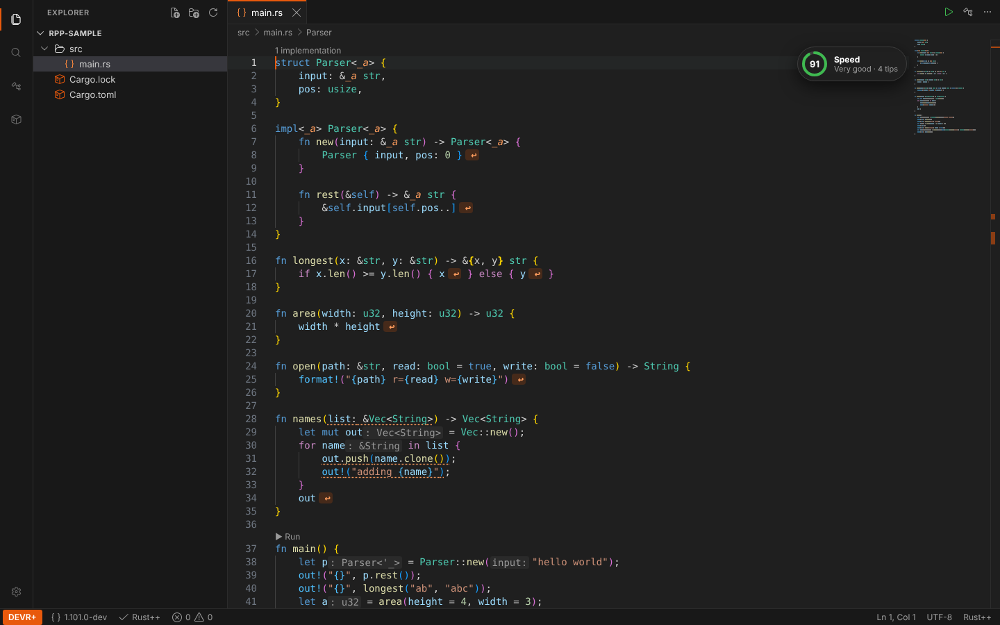

# محرر DEVR+

**DEVR+** هو المحرر المصنوع لـ Rust++. شكله مثل VS Code، فكل شيء في المكان
الذي تتوقعه، لكنه يفهم كل ميزات Rust++.

## التثبيت

نزّل DEVR+ من
[الإصدارات التي اسمها “DEVR+”](https://github.com/AlzelemX/Rust-/releases):

| النظام | الملف |
|---|---|
| ويندوز | `DEVR+_…_x64-setup.exe` |
| لينكس (glibc 2.39+: أوبونتو 24.04+، ديبيان 13+) | `.deb` أو `.AppImage` |
| ماك (Apple Silicon / Intel) | `DEVR+_…_aarch64.dmg` / `DEVR+_…_x64.dmg` |

يستخدم DEVR+ نسخة Rust++ التي ثبّتها بـ `rustup++_init`. إذا لم تكن
موجودة، في صفحة البداية زر **تثبيت Rust++**.

> الماك: التطبيق غير موقّع من Apple بعد. في أول مرة اضغط عليه بالزر الأيمن
> واختر **Open**.

## العربية

من الإعدادات (`Ctrl+,`) اختر **اللغة: العربية**. يصبح المحرر كله بالعربي:
القوائم والأوامر، ورسائل المترجم، والإصلاحات السريعة، ونصائح السرعة، وشرح
المكتبة القياسية، وهذا الكتاب. الكود نفسه يبقى من اليسار إلى اليمين.

العربية موجودة داخل Rust++ نفسها، وليس في المحرر فقط:

- **رسائل المترجم.** يتكلم `rustc` و`cargo` بالعربي عندما يكون متغير البيئة
  `RUSTPP_LANG` يساوي `ar` (يضبطه DEVR+ تلقائيًا، وفي الطرفية التي بداخله أيضًا).
  من أي طرفية: `RUSTPP_LANG=ar cargo build`
  (في PowerShell: `$env:RUSTPP_LANG="ar"; cargo build`). الأسماء والأنواع
  والكود داخل الرسائل تبقى كما هي.
- **شرح المكتبة القياسية.** كل عنصر موثّق في `std` و`core` و`alloc` له شرح
  بالعربي بجانب الإنجليزي في نفس تعليق التوثيق. `Option` و`Result` و`String`
  و`Vec` و`HashMap` وماكروهات الطباعة مشروحة كاملة بالعربي، والباقي ملخص قصير
  حاليًا. يعرض المحلل (analyzer) اللغة التي اخترتها (الإعداد `rustpp.language`:
  `en` أو `ar`)، وأمثلة الكود تظهر في اللغتين.

## أول مشروع

1. **مشروع Rust++ جديد…** في صفحة البداية (أو `Ctrl+Shift+P` ← *Cargo: مشروع Rust++ جديد*).
2. اضغط **F5**: يبنيه Cargo ويشغّله في الطرفية بالأسفل.
3. تظهر الأخطاء أثناء الكتابة؛ والضغط على ملف:سطر باللون الأحمر في الطرفية
   يفتح الملف عند ذلك السطر.

## ما الذي تراه



- **علامات الإرجاع ↩**: بعد القيمة التي ترجعها الدالة.
- **⚡ تقييم السرعة**: بجانب زر التشغيل، من 0 إلى 100. مرّر الماوس عليه لترى
  كل مكان بطيء وطريقة إصلاحه. الأماكن البطيئة تحتها خط منقّط.
- **▶ تشغيل** فوق `fn main`، و**N تطبيقات (impl)** فوق الأنواع.
- **التلميحات** الرمادية: الأنواع التي يستنتجها Rust++ (`: u32`)، وأسماء
  المعاملات في الاستدعاءات التي لا تستخدم [الوسائط بالاسم](../basics/named-arguments.md).
- **كتاب Doc Book** (أيقونة الكتاب على اليسار): هذا الكتاب داخل المحرر،
  بالعربي أو الإنجليزي، ويأتي مع Rust++ المثبتة فيطابق نسختك من اللغة.

## الاختصارات

| المفتاح | ماذا يفعل |
|---|---|
| `Ctrl+P` | فتح ملف بالاسم |
| `Ctrl+Shift+P` | كل الأوامر |
| `Ctrl+T` | الذهاب إلى struct أو trait أو دالة… في المشروع |
| `Ctrl+Shift+T` | لوحة **البحث عن الرموز** مع فلاتر: struct، enum، trait، fn، impl… |
| `Ctrl+Shift+F` | البحث في كل الملفات |
| `F12` / `Shift+F12` | الذهاب إلى التعريف / كل المراجع |
| `Ctrl+F12` | الذهاب إلى كتل `impl` لنوع أو trait |
| `F2` | إعادة التسمية في كل مكان |
| `Ctrl+.` | إصلاح سريع |
| `F8` | الخطأ التالي |
| `F5` / `Ctrl+F5` | تشغيل / تشغيل سريع (`--release`) |
| `Ctrl+Shift+B` | بناء |
| `` Ctrl+` `` | طرفية جديدة |
| `Ctrl+B` / `Ctrl+J` | إظهار أو إخفاء الشريط الجانبي / اللوحة السفلية |
| `Ctrl+,` | الإعدادات (اللغة، الثيم، الخط، التلميحات، تقييم السرعة…) |

على الماك استخدم `⌘` بدلًا من `Ctrl`.

## قسم Cargo

أيقونة الصندوق على اليسار تعرض مشروعك: **تشغيل**، **بناء**، **فحص**،
**اختبار**، **تشغيل سريع** و**تنظيف**، والبرامج التي فيه، ومكتباته. المكتبة
التي لها إصدار أحدث على crates.io يظهر بجانبها باللون الأخضر؛ وزر **+**
يضيف مكتبة (`cargo add`).

## في المتصفح

`devr-server` يقدّم نفس المحرر لمتصفح الإنترنت:

```text
devr-server --ui path/to/devr/ui/dist
```

ثم افتح <http://127.0.0.1:7878>. يستمع فقط على جهازك.
